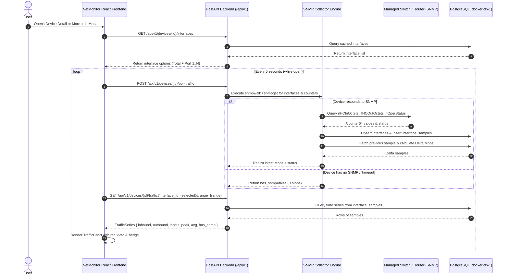

# Real SNMP Bandwidth Monitoring & Traffic Chart Integration Design Spec

- **Author:** Antigravity Pairing Assistant
- **Date:** 2026-11-06
- **Status:** Approved
- **Topic:** Real SNMP Port Bandwidth Polling, Interface Selection, and Traffic Chart Integration

---

## 1. Overview & Business Objectives
NetMonitor currently visualizes network device traffic via a client-side real-time simulation engine (`generateTraffic()` in `traffic.ts`). While visually smooth, production network operations require actual bandwidth metrics pulled directly from managed network hardware (switches, routers, firewalls, and access points).

This feature integrates real SNMP port metrics into the NetMonitor full-stack platform:
1. **Real SNMP Polling Engine:** Poll physical and virtual interfaces using Net-SNMP (IF-MIB and ifXTable 64-bit HC counters) via asynchronous execution.
2. **Bandwidth Delta Calculation:** Compute actual inbound and outbound throughput in Mbps:
   $$\text{Mbps} = \frac{\Delta \text{Octets} \times 8}{\Delta \text{Seconds} \times 1,000,000}$$
3. **Database Metric Storage:** Persist interfaces and metric samples in existing PostgreSQL tables (`interfaces` and `interface_samples`).
4. **Interface Selection UI:** Allow users to view Total Aggregate Bandwidth across all active ports or drill down into specific interfaces (e.g., Port 1 Uplink, Port 2, VLAN).
5. **Strict Mode Handling:** For devices without SNMP capability (e.g. ICMP ping-only nodes, unmanaged appliances), render a flat 0 Mbps line accompanied by an unambiguous `○ No SNMP Data (ICMP Only)` badge.
6. **Active Polling Frequency:** 5-second interval during active modal/page inspection to balance data freshness against switch control-plane CPU load.

---

## 2. Architecture & Data Flow



---

## 3. Detailed Component Specifications

### 3.1 Backend Collector (`backend/app/collector.py`)
- **SNMP OID Standard Mappings:**
  - `ifIndex`: `.1.3.6.1.2.1.2.2.1.1`
  - `ifDescr`: `.1.3.6.1.2.1.2.2.1.2`
  - `ifName`: `.1.3.6.1.2.1.31.1.1.1.1`
  - `ifSpeed`: `.1.3.6.1.2.1.2.2.1.5`
  - `ifHighSpeed`: `.1.3.6.1.2.1.31.1.1.1.15` (Speed in Mbps)
  - `ifPhysAddress`: `.1.3.6.1.2.1.2.2.1.6`
  - `ifOperStatus`: `.1.3.6.1.2.1.2.2.1.8` (1 = up, 2 = down)
  - `ifHCInOctets` (64-bit): `.1.3.6.1.2.1.31.1.1.1.6`
  - `ifHCOutOctets` (64-bit): `.1.3.6.1.2.1.31.1.1.1.10`
  - Fallback: `ifInOctets` (`.1.3.6.1.2.1.2.2.1.10`) and `ifOutOctets` (`.1.3.6.1.2.1.2.2.1.16`)
- **Delta & Wrap-around Handling:**
  - If counter rollover occurs ($\Delta < 0$):
    - For 32-bit: $\Delta = (\text{new} + 2^{32}) - \text{old}$
    - For 64-bit: $\Delta = (\text{new} + 2^{64}) - \text{old}$
  - Validate against max physical port speed ($\text{rate} \le \text{speed\_bps} \times 1.2$) to prevent counter spike anomalies.

### 3.2 Database Schema Alignment
- Uses existing PostgreSQL tables:
  - `interfaces` (`id`, `device_id`, `if_index`, `name`, `description`, `mac_address`, `speed_bps`, `admin_status`, `oper_status`, `discovered_at`)
  - `interface_samples` (`interface_id`, `sampled_at`, `in_octets`, `out_octets`, `in_errors`, `out_errors`, `in_discards`, `out_discards`)
  - Retention query: prune interface samples older than 7 days to maintain optimal table footprint.

### 3.3 REST API Endpoints (`backend/app/main.py`)
1. **`GET /api/v1/devices/{device_id}/interfaces`**
   - Returns list of detected interfaces for the device:
     ```json
     [
       { "id": 1, "if_index": 1, "name": "1", "description": "GigabitEthernet1", "speed_bps": 1000000000, "oper_status": "up" },
       { "id": 2, "if_index": 2, "name": "2", "description": "GigabitEthernet2", "speed_bps": 1000000000, "oper_status": "up" }
     ]
     ```
2. **`POST /api/v1/devices/{device_id}/poll-traffic`**
   - Triggers an immediate asynchronous SNMP poll for all interfaces on the specified device.
   - Computes delta Mbps against the last stored sample.
   - Returns polling summary `{ "success": true, "has_snmp": true, "interfaces_polled": 28, "total_in_mbps": 14.2, "total_out_mbps": 8.7 }`.
3. **`GET /api/v1/devices/{device_id}/traffic`**
   - Query Parameters:
     - `interface_id`: `all` (default) or integer interface ID
     - `range`: `15m` (default), `1h`, `6h`, `24h`, `7d`
   - Returns `TrafficSeriesResponse`:
     ```json
     {
       "has_snmp": true,
       "interface_id": "all",
       "inbound": [12.4, 13.1, 14.2, ...],
       "outbound": [6.2, 7.0, 8.7, ...],
       "labels": ["-15m", "-10m", "-5m", "now"],
       "peak": 18.5,
       "avg": 11.2,
       "timestamp": "2026-11-06T14:40:00Z"
     }
     ```
   - For ICMP-only devices:
     ```json
     {
       "has_snmp": false,
       "interface_id": "all",
       "inbound": [0, 0, 0, 0],
       "outbound": [0, 0, 0, 0],
       "labels": ["-15m", "-10m", "-5m", "now"],
       "peak": 0,
       "avg": 0,
       "timestamp": "2026-11-06T14:40:00Z"
     }
     ```

### 3.4 Frontend Components & State Management
1. **API Service (`netmonitor/src/services/api.ts`):**
   - `fetchDeviceInterfaces(deviceId: string): Promise<InterfaceOut[]>`
   - `pollDeviceTraffic(deviceId: string): Promise<PollTrafficResult>`
   - `fetchDeviceTraffic(deviceId: string, interfaceId: string, range: TimeRange): Promise<TrafficSeries>`
2. **Hook (`netmonitor/src/hooks/useDeviceDetail.ts`):**
   - Maintains `selectedInterface: string` (defaults to `'all'`).
   - Polls backend every 5 seconds when modal/page is active.
   - Sets `hasSnmp` flag from backend response.
3. **UI Controls (`TrafficChart.tsx` & Headers):**
   - If `has_snmp == true`: Badge displays `● LIVE (SNMP)`.
   - If `has_snmp == false`: Badge displays `○ No SNMP Data (ICMP Only)`.
   - Port selector `<select>` or pill group:
     - `All Interfaces (Total Aggregate)`
     - `Port {name} ({oper_status})`

---

## 4. Error Handling & Edge Cases
1. **SNMP Request Timeout / Port unreachable:**
   - Handled gracefully via `asyncio.wait_for()` with a 2-second timeout. Does not block the event loop or crash FastAPI.
2. **First Sample (No previous $\Delta t$ baseline):**
   - First poll records initial octets count into DB; returns 0.0 Mbps until the second sample arrives 5 seconds later.
3. **Rapid Interface Switching:**
   - AbortController cancels pending in-flight traffic queries when the user rapidly switches dropdown interfaces or time ranges.
4. **Counter Overflow / Zero Division:**
   - Guard against $\Delta t \le 0$ or negative values with standard RFC counter wraparound logic.

---

## 5. Verification & Testing Plan
1. **Unit & Integration Tests (`backend/tests/test_snmp_collector.py`):**
   - Test delta bandwidth calculation algorithm (normal, counter reset, wrap-around).
   - Test interface parsing from Net-SNMP output.
   - Test database insertion and retrieval of `interface_samples`.
2. **Live SNMP Hardware Test (`backend/tests/test_real_port_traffic.py`):**
   - Execute against the live Aruba JL261A switch at `192.168.22.254`.
   - Verify `interfaces` table populated with 28 ports.
   - Verify two consecutive polls produce non-zero bandwidth readings.
3. **Frontend Integration Test:**
   - Verify dropdown interface selector renders and filters data correctly.
   - Verify 5-second polling updates graph points.
   - Verify `○ No SNMP Data (ICMP Only)` on ping-only devices.
